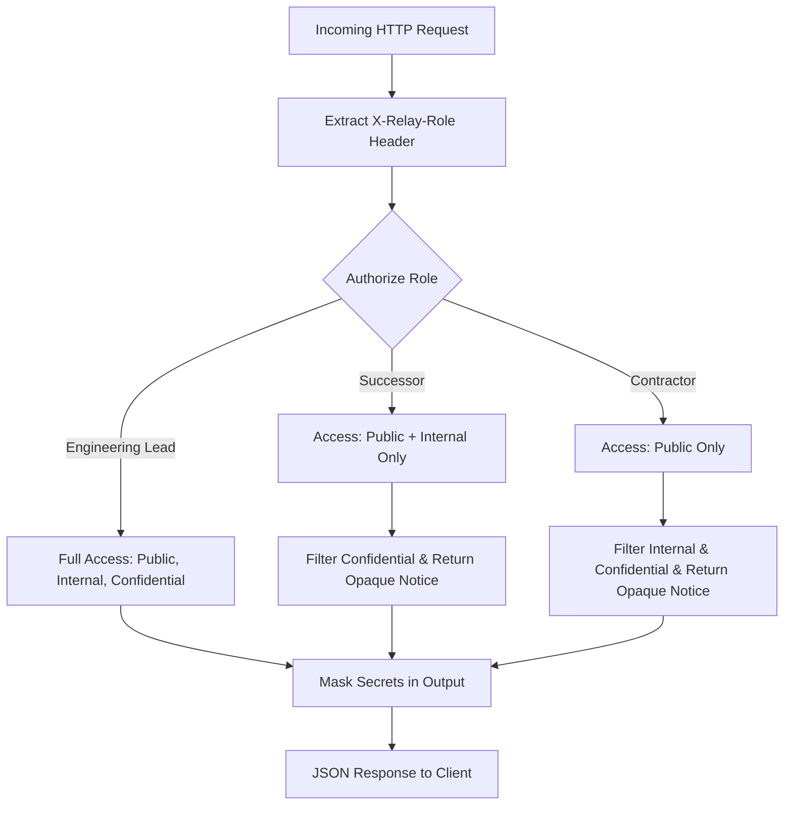

# Privacy & Responsible Design Architecture

## Core Philosophy

Engineering offboarding naturally handles high-sensitivity information: internal discussions, confidential architectural debt, credentials, personnel notes, and security incidents. Presenting uncurated automated summaries or exposing raw connected data directly to successors introduces severe privacy, compliance, and operational risks.

RELAY AI is designed around three strict responsible AI principles:
1. **Never Present Assumptions as Verified Truth**
2. **Permission-Aware Filtering Enforced at the Data Layer**
3. **Zero Secrets Stored or Displayed Unredacted**

---

## 1. Role-Based Access Control (RBAC) Architecture



### Role Hierarchy
- `engineering_lead`: Department head or designated review manager. Has oversight across all connected channels, confidential rotation procedures, and review privileges.
- `successor`: The incoming primary maintainer taking over the departing engineer's responsibilities. Granted access to technical documents, public repos, and team engineering channels, but barred from confidential HR or security rotation records.
- `contractor`: External or temporary contributors. Restricted exclusively to public repository artifacts and open documentation.

### Opaque Withheld Disclosures
When items are withheld due to access restrictions, the API response never reveals sensitive metadata:
```json
{
  "items": [...visible artifacts...],
  "withheld_count": 3,
  "withheld_notice": "3 item(s) withheld due to access restrictions"
}
```
Titles, channel names, dates, and authors of withheld records are purged server-side to prevent metadata leakage.

---

## 2. Secrets & Credential Sanitization

Prior to storing artifacts in the database or displaying them in the user interface, RELAY AI applies automated regular expression pattern scanners targeting:
- Stripe Live / Test Secret Keys (`sk_live_...`, `sk_test_...`)
- AWS Access Keys & Secret Keys (`AKIA...`, `AWS_SECRET_ACCESS_KEY=...`)
- JWT Signatures and Bearer Tokens
- GitHub Personal Access Tokens (`ghp_...`, `github_pat_...`)
- Slack Bot & User Tokens (`xoxb-...`, `xoxp-...`)
- Database Connection Strings (`postgresql://...`)

### Redaction Policy
- Values are masked with `[REDACTED]` immediately.
- Only the artifact ID, credential type, and line reference are preserved in the system audit log (e.g. `ENV_KEYS.md:line 3`). Raw secrets never enter embeddings or LLM context windows.

---

## 3. Anti-Hallucination & Provenance Tagging

Offboarding documentation must be dependable. Fabricated commands or invented configuration keys can cause severe downtime during subsequent deployments.

### Provenance Classification
- **VERIFIED**: Claims corroborated by at least two independent primary sources (e.g. a resolved Jira ticket validated against a production commit or API test).
- **STATED**: Information provided directly by the departing engineer during the targeted interview without secondary corroboration.
- **INFERRED**: Synthesized architectural deduction based on discussion threads or draft PR descriptions.
- **UNKNOWN**: Explicitly marked gaps where evidence is missing or conflicting. The system refuses to fabricate answers for missing facts.

### Grounding Verification Pass
Synthesized handover items are audited by a verifier pass calculating citation token overlap. Sentences failing grounding thresholds are flagged or downgraded to `INFERRED`, accompanied by an overall document Grounding Score (e.g. `82% → 94%`).

---

## 4. Immutable Audit Trail

Every state change throughout the offboarding workflow is permanently recorded with timestamp, actor identity, and description:
- Case creation and source synchronization
- Interview question dispatch and leaver answer submissions
- Claim approval, rejection (with mandatory reason), and inline text modifications
- Document release and successor receipt acknowledgement
