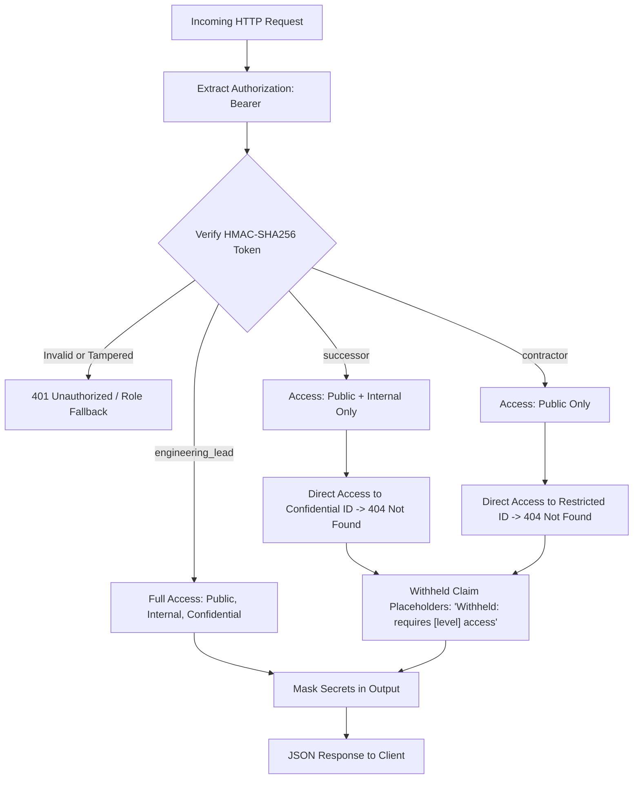

# Privacy & Responsible Design Architecture

## Core Philosophy

Engineering offboarding naturally handles high-sensitivity information: internal discussions, confidential architectural debt, credentials, personnel notes, and security incidents. Presenting uncurated automated summaries or exposing raw connected data directly to successors introduces severe privacy, compliance, and operational risks.

RELAY AI is designed around three strict responsible AI principles:
1. **Never Present Assumptions as Verified Truth**
2. **Permission-Aware Filtering Enforced at the Data Layer**
3. **Zero Secrets Stored or Displayed Unredacted**

---

## 1. Role-Based Access Control (RBAC) Architecture

### Server-Derived Roles (demo authentication)
- Authorization is strictly derived from server-signed HMAC-SHA256 tokens issued via `POST /auth/demo-login`.
- The client-side role switcher selects among seeded demo personas (`lead`, `successor`, `contractor`), but cannot assert permissions directly.
- The former client-supplied `X-Relay-Role` header is only used as an initial hint for user selection; all endpoint security derives exclusively from the verified bearer token.

### Existence Privacy (404 on Direct Access)
When a user attempts direct direct access by ID (`GET /artifacts/{id}`) to a resource their role is not authorized to inspect:
- The server returns **HTTP 404 Not Found** (never HTTP 403 Forbidden).
- This guarantees that an unauthorized user cannot discover whether a sensitive resource (e.g. severance discussion or private credential rotation ticket) exists in the system.
- Withheld counts across timeline and findings remain aggregate-only with all titles, timestamps, and authors purged.

### Withheld Claim Placeholders
If a synthesized handover claim depends on evidence the active role cannot access:
- The text is replaced with `"Withheld: requires [level] access"`.
- The citation is replaced with `["[withheld]"]`.
- The claim is never silently dropped (which would create false confidence) nor displayed uncited.

---

## 2. Secrets & Credential Sanitization

Prior to storing artifacts or displaying them in the user interface, RELAY AI applies automated regular expression pattern scanners targeting:
- Stripe Live / Test Secret Keys (`sk_live_...`, `sk_test_...`)
- AWS Access Keys & Secret Keys (`AKIA...`, `AWS_SECRET_ACCESS_KEY=...`)
- SendGrid API Keys (`SG....`)
- JWT Signatures and Bearer Tokens
- GitHub Personal Access Tokens (`ghp_...`, `github_pat_...`)
- Slack Bot & User Tokens (`xoxb-...`, `xoxp-...`)
- Database Connection Strings (`postgresql://...`)

### Redaction Policy
- Values are masked with `[REDACTED]` immediately.
- Only the artifact ID, credential type, and line reference are preserved in the system audit log (e.g. `ENV_KEYS.md:line 3`). Raw secrets never enter embeddings or LLM context windows.

---

## 3. Anti-Hallucination, Grounding & Provenance Tagging

Offboarding documentation must be dependable. Fabricated commands or invented configuration keys can cause severe downtime during subsequent deployments.

### Provenance Classification
- **VERIFIED**: Claims corroborated by cited primary evidence with high lexical and entity overlap.
- **STATED**: Information provided directly by the departing engineer during the targeted interview without secondary corroboration.
- **INFERRED**: Synthesized architectural deduction based on discussion threads or draft PR descriptions.
- **UNKNOWN**: Explicitly marked gaps where evidence is missing or conflicting. The system refuses to fabricate answers for missing facts.

### Deterministic Sentence-Level Grounding Verifier
Synthesized handover items are audited by an offline deterministic verifier:
- Evaluates non-stopword lexical token containment and exact domain entity recall (numbers, percentages, ticket keys, environment variables, code paths, and proper nouns).
- Unsupported sentences failing grounding thresholds are downgraded to `INFERRED` or `UNKNOWN` and flagged with diagnostic reasons.
- Displays an aggregate document Grounding Score with the exact method stated: `deterministic lexical and entity overlap (offline)`.

---

## 4. Immutable Version History & Release Gating

Every state change throughout the offboarding workflow is permanently recorded:
- **Numbered Immutable Versions**: Every edit, approval, rejection, and release increments the version and creates a permanent snapshot (author, timestamp, change summary).
- **Release Gating**: Engineering leads cannot release a handover document until 100% of claims are approved, edited, or rejected. Unreviewed draft claims block release with HTTP 400.
- **Exclusion of Rejected Claims**: Claims rejected by the lead are permanently purged from released snapshots.
- **Versioned Receipt Acknowledgement**: When a successor acknowledges receipt, the acknowledgement binds immutably to the specific released version number.

---

## 5. Role-Aware Simulation & Honest Feedback Loop

- **Role-Restricted Onboarding Simulation**: The blind onboarding agent simulation is strictly bounded by the active role's ACL permissions. When evaluated as a contractor, internal infrastructure secrets and migration backfills are withheld, reducing completeness from 71% to 36%.
- **Dynamically Computed Scoring**: The readiness formula (`found required facts / total required facts`, weighted) is computed dynamically from the fact checklist—never hardcoded.
- **Lead-Confirmed Fix Loop**: Follow-up questions generated by the fix loop display suggested answers labeled explicitly as `demo-suggested answers` and require lead confirmation checkboxes before re-scoring.

---

## 6. Known Limitations

1. **Demo Authentication**: Uses signed HMAC-SHA256 bearer tokens with a fixed secret for offline evaluation; not intended for production multi-tenant OAuth/SAML deployments.
2. **Pattern-Based Redaction**: Secrets redaction relies on regular expressions. Novel or non-standard token formats without standard prefixes may not be caught.
3. **Synthetic Seed Fixtures**: Default demo runs on realistic synthetic fixtures (`seed/`) for offline stability and judge evaluation.
4. **Deterministic Lexical Verifier**: Offline grounding verification relies on lexical and domain entity overlap rather than deep GPU neural entailment models.

---

## 7. Disclosure

- **AI Tools Used**: Google Gemini (via Gemini 1.5 Flash API for prompt generation, and Antigravity assistant for pair programming) and Anthropic Claude for architecture consultation and code auditing.
- **Third-Party Libraries**: FastAPI, Pydantic, SQLAlchemy, Uvicorn, React 18, React Router v6, Tailwind CSS, Vite, Vitest, pytest.
- **Timing**: All security hardening, verifiers, workflow gating, and test suites were implemented during the hackathon window.

