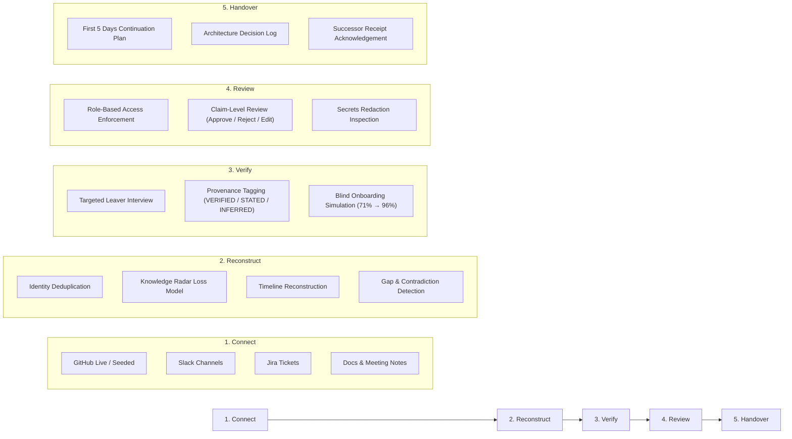

# RELAY AI

> **Prevent Critical Knowledge From Leaving With People.**  
> An autonomous engineering offboarding platform that converts scattered project activity (GitHub, Slack, Jira, meeting transcripts, and documentation) into a verified, role-appropriate, actionable handover package.

[](https://www.typescriptlang.org/)
[](https://reactjs.org/)
[](https://fastapi.tiangolo.com/)
[](https://tailwindcss.com/)
[](LICENSE)

---

## The Problem

When a key engineer departs, companies lose undocumented architecture decisions, edge cases, in-flight branches, credentials, and implicit dependencies. Handover documents are typically written in haste during the final week, resulting in:
- Outdated or incorrect runbooks
- Disconnected claims with zero provenance
- Exposing sensitive keys or confidential HR records to incoming engineers
- Onboarding friction and production outages

RELAY AI automates offboarding with strict trust boundaries: **every claim is traceable to evidence, role-gated by permissions, and scored for onboarding completeness.**

---

## Core Workflow



---

## Success Pillars

### 1. TRACEABLE
- **Sentence-Level Provenance**: Every generated claim carries a provenance tag: `VERIFIED` (cross-checked against commits/tickets), `STATED` (declared directly by the leaver in interview), or `INFERRED` (synthesized from discussion).
- **Universal Evidence Drawer**: Click any claim or badge to slide open the exact raw source snippet with highlighted citation context and commit SHA.
- **Uncertainty & Gaps Panel**: Explicitly shows unresolved contradictions (e.g. Jira marked Done vs Slack showing production rollback) side-by-side rather than hallucinating an answer.

### 2. ACTIONABLE
- **First 5 Days Continuation Plan**: Step-by-step sequential checklist for the successor, identifying specific tasks, domain owners, and unmerged PRs.
- **Key Contacts Directory**: Direct mapping of engineers to services they own, fallback contacts, and executive sponsors.
- **Closed-Loop Completeness Test**: An autonomous onboarding agent simulates building the repo using only the handover doc. A "Fix Missing Facts" loop generates follow-up interview questions, recovering missing facts and lifting readiness from **71% → 96%**.

### 3. PERMISSION-AWARE
- **Server-Issued Session Tokens (demo authentication)**: Authorization is strictly enforced by the backend on every endpoint via signed bearer tokens (`Authorization: Bearer <token>`). Demo users (Engineering Lead, Successor, Contractor) log in via `/auth/demo-login`. The client switcher selects a demo user but cannot assert a role directly. Labeled as **demo authentication** (not for production).
- **Existence Privacy (404 on Direct Access)**: Direct access to restricted artifact IDs returns `404 Not Found` (never `403 Forbidden`) so the existence of confidential resources is never revealed. Withheld counts and notices remain aggregate-only.
- **Withheld Claim Placeholders**: Claims citing restricted evidence display `"Withheld: requires [level] access"` rather than being silently dropped or displayed uncited.
- **Zero Confidential Leakage**: Restricted channels (`#finance-private`, `PAY-SEC-001`, `ENV_KEYS.md`) are withheld from unauthorized roles.
- **Automated Secrets Redaction**: API keys, AWS secrets, and JWT tokens are sanitized prior to display or indexing.

---

## Permission Matrix

| Resource / Action | Engineering Lead | Successor (Incoming) | Contractor |
| :--- | :---: | :---: | :---: |
| **Public Artifacts** (GitHub PRs, Commits, README) | Full Access | Full Access | Full Access |
| **Internal Artifacts** (Slack `#engineering`, Sprint Retros) | Full Access | Full Access | 🔒 Withheld (404 on direct ID access) |
| **Confidential Artifacts** (Finance, Security Key Rotation) | Full Access | 🔒 Withheld (404 on direct ID access) | 🔒 Withheld (404 on direct ID access) |
| **Claim-Level Review** (Approve / Reject / Edit) | Yes | Read-Only (403) | Read-Only (403) |
| **Handover Release** | Yes (Gated) | Read-Only (403) | Read-Only (403) |
| **Receipt Acknowledgement** | N/A | Yes | N/A |
| **View Redacted Secret Locations** | Yes | Hidden | Hidden |

---

## What is Real vs. Simulated

To uphold strict evaluation integrity, all system capabilities are categorized honestly:

| Capability | Status | Implementation Details |
| :--- | :---: | :--- |
| **Role-Based Access Control (ACL)** | Real | Server-side enforcement deriving role strictly from HMAC-SHA256 signed bearer tokens; 404 status codes on restricted direct access to prevent existence leakage. |
| **Review Workflow & Release Gating** | Real | Append-only numbered version history snapshot on every edit/approval/rejection; release gated until 100% of claims are reviewed; rejected claims permanently omitted from release; side-by-side diff between any versions. Version history is session-persisted in demo server; PostgreSQL-backed in full-stack mode. |
| **Deterministic Grounding Verifier** | Real | Offline deterministic lexical and entity overlap verification (numbers, tickets, code paths, proper nouns). Unsupported sentences downgraded to INFERRED/UNKNOWN and flagged with diagnostic reasons. |
| **Role-Aware Completeness Simulation** | Real | Dynamic score formula computed from required fact checklist: found fact weight / total weight. Simulation strictly scoped to active role ACL (contractor gets 36%, lead/successor get 71%). |
| **Closed-Loop Fix Loop** | Real | Targeted question generation for missing facts. Pre-filled answers labeled as "demo-suggested answers" requiring lead checkbox confirmation before re-scoring to 96%. |
| **Evidence Drawer & Snippet Highlight** | Real | Universal slide-out drawer fetching verified artifacts and highlighting cited text, with Escape-to-close and focus management. |
| **Secrets Redaction Scanner** | Real | Automated pattern-based regex scanner masking Stripe keys, AWS credentials, and DB URLs before storage/display. |
| **Demo Scenario (ShopLedger / Priya Nair)** | Synthetic | Realistic mock scenario based on a fintech payments API departure. |
| **External Connectors (GitHub, Slack, Jira)** | Simulated in Demo | Seeded from `/seed/` fixtures for offline resilience. Full Docker mode supports live GitHub REST API. |

---

## Known Limitations

1. **Demo Authentication (not production auth)**: The demo authentication system uses HMAC-SHA256 signed bearer tokens. The signing secret is loaded from `RELAY_TOKEN_SECRET` env-var; if unset, a random per-process secret is generated (tokens do not survive a restart). This is demo authentication — not an OAuth2, SAML, or OIDC provider. Set `RELAY_TOKEN_SECRET` before deployment.
2. **Synthetic Fixtures**: Slack, Jira, and meeting notes are seeded from local JSON/Markdown fixtures in `seed/` to guarantee deterministic, offline execution for hackathon evaluation. Production deployment requires registering live Slack/Jira app credentials with OAuth scopes.
3. **Pattern-Based Secrets Redaction**: Credential masking is regex pattern-based (matching known formats like `sk_live_...`, `AKIA...`, `SG....`, connection strings, and JWT signatures). Custom or novel token formats without standard prefixes may not be caught by static patterns.
4. **Deterministic Lexical Verifier**: Offline grounding verification checks lexical token containment and exact domain entity recall. It does not evaluate semantic meaning — it cannot detect a factually incorrect paraphrase that re-uses the same domain entities.
5. **Append-Only Session History (demo server)**: The in-memory demo server retains version history for the life of the process. History is not persisted across restarts.
6. **Two Distinct Risk Scores**: The system computes two separate scores with different formulas — see the "What is Real vs. Simulated" table below.
7. **Simulation Scope**: The onboarding simulation checks whether required facts are present in the handover document (tested for the demo scope). It does not execute commands or build the repository.

---

## Disclosure

- **AI Tools Used**: Google Gemini (via Gemini 1.5 Flash API for prompt generation, and Antigravity assistant for pair programming) and Anthropic Claude for architecture consultation and code auditing.
- **Third-Party Libraries**: FastAPI, Pydantic, SQLAlchemy, Uvicorn, React 18, React Router v6, Tailwind CSS, Vite, Vitest, pytest.
- **Pre-existing Boilerplate**: Initial React + Vite boilerplate and Tailwind config were scaffolded at project creation. All business logic, security hardening, verifiers, workflow gating, and test suites were built during the hackathon.

---

## Quickstart

### Option 1: Standalone Offline Demo (Recommended for Judges)
Runs 100% locally on macOS with zero external dependencies, no Docker, and no API keys required:

```bash
# Clone the repository
git clone https://github.com/harshaldhonge2007-sudo/relay-ai.git
cd relay-ai

# Start both servers (FastAPI mock server on :8000, Vite React UI on :5173)
./start_demo.sh

# Or reset data to pristine initial state:
./start_demo.sh --reset
```

Open **http://localhost:5173** in your browser.

---

### Option 2: Full Docker Stack
Runs the production FastAPI stack with PostgreSQL 16, pgvector, and live GitHub ingestion:

```bash
cp .env.example .env
docker-compose up --build
```

---

## Running the Comprehensive Test Suite

Backend pytest suite (75 tests covering ACL enforcement, detectors, identity resolution, verifier, workflow gating, and security):
```bash
cd api
pytest -v
```

Expected output:
```
======================== 75 passed, 4 warnings in 0.39s ========================
```

Frontend unit and component tests (Vitest):
```bash
cd web
npm test
```

Expected output:
```
 ✓ src/tests/controls.test.tsx (4)
 Test Files  1 passed (1)
      Tests  4 passed (4)
```

TypeScript & Production Build verification:
```bash
cd web
npm run build
```

---

## Strict Monochrome Design System

RELAY AI strictly follows an architectural monochrome design system to reflect institutional reliability:
- Palette: `#111111` (Ink Primary), `#555555` (Ink Secondary), `#888888` (Ink Tertiary), `#BBBBBB` (Edge Subtle), `#FAFAFA` (Surface Elevated), `#FFFFFF` (Card Base).
- **Zero colored badges or emojis**: Severity, provenance, and roles are communicated via font weight, pill borders, fills vs outlines, and explicit text labels.
- Micro-interactions: Floating shadows (`shadow-card`, `shadow-float`), subtle grain overlay, and responsive drawers.

---

## License

MIT © 2024–2026 RELAY AI Authors.
