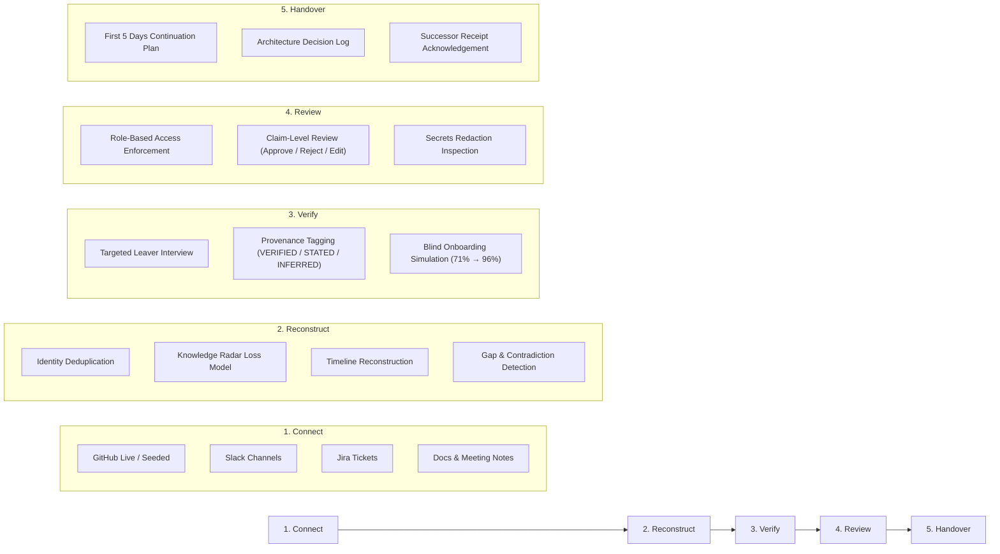

# RELAY AI

> **Prevent Critical Knowledge From Leaving With People.**  
> An autonomous engineering offboarding platform that converts scattered project activity (GitHub, Slack, Jira, meeting transcripts, and documentation) into a verified, role-appropriate, actionable handover package.

[](https://www.typescriptlang.org/)
[](https://reactjs.org/)
[](https://fastapi.tiangolo.com/)
[](https://tailwindcss.com/)
[](LICENSE)

---

## The Problem

When a key engineer departs, companies lose undocumented architecture decisions, edge cases, in-flight branches, credentials, and implicit dependencies. Handover documents are typically written in haste during the final week, resulting in:
- Outdated or incorrect runbooks
- Disconnected claims with zero provenance
- Exposing sensitive keys or confidential HR records to incoming engineers
- Onboarding friction and production outages

RELAY AI automates offboarding with strict trust boundaries: **every claim is traceable to evidence, role-gated by permissions, and scored for onboarding completeness.**

---

## Core Workflow



---

## Success Pillars

### 1. TRACEABLE
- **Sentence-Level Provenance**: Every generated claim carries a provenance tag: `VERIFIED` (cross-checked against commits/tickets), `STATED` (declared directly by the leaver in interview), or `INFERRED` (synthesized from discussion).
- **Universal Evidence Drawer**: Click any claim or badge to slide open the exact raw source snippet with highlighted citation context and commit SHA.
- **Uncertainty & Gaps Panel**: Explicitly shows unresolved contradictions (e.g. Jira marked Done vs Slack showing production rollback) side-by-side rather than hallucinating an answer.

### 2. ACTIONABLE
- **First 5 Days Continuation Plan**: Step-by-step sequential checklist for the successor, identifying specific tasks, domain owners, and unmerged PRs.
- **Key Contacts Directory**: Direct mapping of engineers to services they own, fallback contacts, and executive sponsors.
- **Closed-Loop Completeness Test**: An autonomous onboarding agent simulates building the repo using only the handover doc. A "Fix Missing Facts" loop generates follow-up interview questions, recovering missing facts and lifting readiness from **71% → 96%**.

### 3. PERMISSION-AWARE
- **Server-Side ACL Enforcement**: Authorization is strictly enforced by the backend on every endpoint (`X-Relay-Role` header).
- **Zero Confidential Leakage**: Restricted channels (`#finance-private`, `PAY-SEC-001`, `ENV_KEYS.md`) are withheld from unauthorized roles. Withheld counts and notices are opaque—they never leak titles, dates, or metadata.
- **Automated Secrets Redaction**: API keys, AWS secrets, and JWT tokens are sanitized prior to display or indexing.

---

## Permission Matrix

| Resource / Action | Engineering Lead | Successor (Incoming) | Contractor |
| :--- | :---: | :---: | :---: |
| **Public Artifacts** (GitHub PRs, Commits, README) | Full Access | Full Access | Full Access |
| **Internal Artifacts** (Slack `#engineering`, Sprint Retros) | Full Access | Full Access | 🔒 Withheld |
| **Confidential Artifacts** (Finance, Security Key Rotation) | Full Access | 🔒 Withheld (403) | 🔒 Withheld (403) |
| **Claim-Level Review** (Approve / Reject / Edit) | Yes | Read-Only | Read-Only |
| **Handover Release** | Yes | Read-Only | Read-Only |
| **Receipt Acknowledgement** | N/A | Yes | N/A |
| **View Redacted Secret Locations** | Yes | Hidden | Hidden |

---

## What is Real vs. Simulated

To uphold strict evaluation integrity, all system capabilities are categorized honestly:

| Capability | Status | Implementation Details |
| :--- | :---: | :--- |
| **Role-Based Access Control (ACL)** | Real | Server-side enforcement with 403 status codes and opaque withheld notices. |
| **Claim-Level Human Review** | Real | Granular claim approve, reject (with reason), and inline edit with version history. |
| **Evidence Drawer & Snippet Highlight** | Real | Universal slide-out drawer fetching verified artifacts and highlighting cited text. |
| **Closed-Loop Simulation (71% → 96%)** | Real | Dynamic question generation, handover regeneration, and live score recalculation. |
| **Secrets Redaction Scanner** | Real | Automated regex scanner masking Stripe keys, AWS credentials, and DB URLs. |
| **Demo Scenario (ShopLedger / Priya Nair)** | Synthetic | Realistic mock scenario based on a fintech payments API departure. |
| **External Connectors (GitHub, Slack, Jira)** | Simulated in Demo | Seeded from `/seed/` fixtures for offline resilience. Full Docker mode supports live GitHub REST API. |

---

## Quickstart

### Option 1: Standalone Offline Demo (Recommended for Judges)
Runs 100% locally on macOS with zero external dependencies, no Docker, and no API keys required:

```bash
# Clone the repository
git clone https://github.com/harshaldhonge2007-sudo/relay-ai.git
cd relay-ai

# Start both servers (FastAPI mock server on :8000, Vite React UI on :5173)
./start_demo.sh

# Or reset data to pristine initial state:
./start_demo.sh --reset
```

Open **http://localhost:5173** in your browser.

---

### Option 2: Full Docker Stack
Runs the production FastAPI stack with PostgreSQL 16, pgvector, and live GitHub ingestion:

```bash
cp .env.example .env
docker-compose up --build
```

---

## Running the Security & ACL Test Suite

The security model is backed by automated tests:

```bash
cd api
python3 -m pytest tests/test_acl.py
```

Expected output:
```
tests/test_acl.py .......                                                [100%]
========================= 7 passed in 0.27s =========================
```

Frontend compilation test:
```bash
cd web
npx tsc --noEmit
npm run build
```

---

## Strict Monochrome Design System

RELAY AI strictly follows an architectural monochrome design system to reflect institutional reliability:
- Palette: `#111111` (Ink Primary), `#555555` (Ink Secondary), `#888888` (Ink Tertiary), `#BBBBBB` (Edge Subtle), `#FAFAFA` (Surface Elevated), `#FFFFFF` (Card Base).
- **Zero colored badges or emojis**: Severity, provenance, and roles are communicated via font weight, pill borders, fills vs outlines, and explicit text labels.
- Micro-interactions: Floating shadows (`shadow-card`, `shadow-float`), subtle grain overlay, and responsive drawers.

---

## License

MIT © 2024–2026 RELAY AI Authors.
