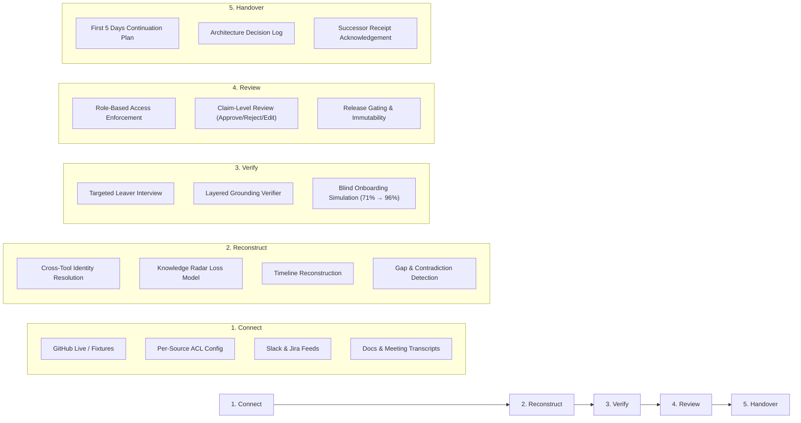

# RELAY AI

> **Prevent Critical Knowledge From Leaving With People.**  
> An autonomous engineering offboarding and knowledge continuity platform that converts scattered project activity (GitHub, Slack, Jira, meeting transcripts, and documentation) into a verified, role-appropriate, actionable handover package.

[](https://www.typescriptlang.org/)
[](https://reactjs.org/)
[](https://fastapi.tiangolo.com/)
[](https://tailwindcss.com/)
[](LICENSE)

---

## The Problem

When a key engineer departs, companies lose undocumented architecture decisions, edge cases, in-flight branches, credentials, and implicit dependencies. Handover documents are typically written in haste during the final week, resulting in:
- Outdated or incorrect runbooks
- Disconnected claims with zero provenance
- Exposing sensitive keys or confidential HR records to incoming engineers
- Onboarding friction, production outages, and institutional memory loss

RELAY AI automates offboarding with strict trust boundaries: **every claim is traceable to evidence, role-gated by permissions, verified for grounding, and scored for onboarding completeness.**

---

## The Three Committed Improvements (Round 3)

| Improvement | Commitment Status | Delivery Summary | Evidence & Test Location |
| :--- | :---: | :--- | :--- |
| **1. Configurable Per-Source ACLs** | **DELIVERED** | Engineering leads can change each source's access level (`public`, `internal`, `confidential`) after import. Changes immediately apply to all derived views (artifacts, findings, timeline, simulation), require explicit confirmation when loosening permissions, write to the immutable audit log, and generate a new handover version snapshot if the case was already released. | Route: `PATCH /cases/{id}/sources/{name}/acl`<br>UI: `Admin.tsx` Connectors panel<br>Tests: `test_round3_improvements.py` |
| **2. Layered LLM Entailment Verifier** | **DELIVERED** | A two-stage verifier where the offline deterministic lexical and entity verifier always executes first. For ambiguous grounding scores `[0.35, 0.75)`, an optional LLM entailment layer is consulted with strict XML data delimiters preventing prompt injection. Offline fallback is preserved and clearly labeled (`deterministic lexical and entity overlap (offline)`). Erroneous or garbage LLM responses safely default to deterministic scores and never upgrade unverified claims. | Class: `LLMEntailmentVerifier`<br>Provider: `app/llm/provider.py`<br>Tests: `test_round3_improvements.py` |
| **3. Live Read-Only GitHub Connector** | **DELIVERED** | Native live GitHub repository ingestion using `aiohttp` with ETag conditional caching, rate-limit backoff, and pagination. Strictly read-only (zero write scopes, zero mutation requests). Automated credential redaction is executed at ingest time before storage. When offline or in demo mode, connector falls back seamlessly to pre-indexed fixture files explicitly labeled `"CACHED FIXTURES — offline fallback"`. | Class: `LiveGitHubIngestor`<br>UI: `LiveRepoIngestion.tsx`<br>Tests: `test_github_live.py`, `test_round3_improvements.py` |

---

## Core Workflow



---

## Success Pillars

### 1. TRACEABLE & GROUNDED
- **Sentence-Level Provenance**: Every generated claim carries a provenance tag: `VERIFIED` (cross-checked against commits/tickets), `STATED` (declared by leaver in interview), or `INFERRED` (synthesized from discussion).
- **Layered Grounding Verifier**: Deterministic lexical and entity overlap verifier paired with optional LLM entailment checking. Unsupported claims are downgraded and flagged with diagnostic failure reasons.
- **Universal Evidence Drawer**: Click any claim or badge to slide open the exact raw source snippet with highlighted citation context and commit SHA.
- **Uncertainty & Gaps Panel**: Explicitly displays unresolved contradictions (e.g. Jira marked Done vs Slack showing production rollback) side-by-side with resolution status.

### 2. ACTIONABLE & CLOSED-LOOP
- **First 5 Days Continuation Plan**: Step-by-step sequential checklist for the successor, identifying specific tasks, domain owners, and unmerged PRs.
- **Key Contacts Directory**: Direct mapping of engineers to services they own, fallback contacts, and executive sponsors.
- **Closed-Loop Completeness Test**: An autonomous onboarding agent simulates building the repo using only the handover doc. A "Fix Missing Facts" loop generates follow-up interview questions, recovering missing facts and lifting readiness from **71% → 96%**.
- **Living Project Memory & Webhooks**: Ingests real-time GitHub commits and PR events to keep knowledge graphs and Bus-Factor alerts current.

### 3. PERMISSION-AWARE & SECURE
- **Server-Issued Session Tokens (demo authentication)**: Authorization is strictly enforced by the backend on every endpoint via signed bearer tokens (`Authorization: Bearer <token>`). Demo users (Engineering Lead, Successor, Contractor) log in via `/auth/demo-login`. Labeled as **demo authentication** (not for production).
- **Configurable Per-Source ACLs**: Leads can dynamically tune the access level (`public`, `internal`, `confidential`) of each integrated tool, updating all derived views instantly with audit trail logging.
- **Existence Privacy (404 on Direct Access)**: Direct ID access returns 404; aggregate withheld counts are disclosed by design so the successor knows the view is partial (configurable per case via `disclose_withheld_counts`).
- **Permission Canary Verification**: Verified by automated canary sweeps (`make leak-test`), proving zero confidential (`CANARY_CONF_7f3a`) or internal (`CANARY_INT_91bc`) data leaks across routes, PDF export, Q&A, and derived metrics.
- **Withheld Claim Placeholders**: Claims citing restricted evidence display `"Withheld: requires [level] access"` rather than leaking confidential details.
- **Automated Secrets Redaction**: API keys, AWS secrets, and JWT tokens are sanitized prior to display or indexing.

---

## Permission Matrix

| Resource / Action | Engineering Lead | Successor (Incoming) | Contractor |
| :--- | :---: | :---: | :---: |
| **Public Artifacts** (GitHub PRs, Commits, README) | Full Access | Full Access | Full Access |
| **Internal Artifacts** (Slack `#engineering`, Sprint Retros) | Full Access | Full Access | 🔒 Withheld (404 on direct ID access) |
| **Confidential Artifacts** (Finance, Security Key Rotation) | Full Access | 🔒 Withheld (404 on direct ID access) | 🔒 Withheld (404 on direct ID access) |
| **Source ACL Configuration** | Full Access (PATCH) | Read-Only (403) | Read-Only (403) |
| **Claim-Level Review** (Approve / Reject / Edit) | Yes | Read-Only (403) | Read-Only (403) |
| **Handover Release** | Yes (Gated) | Read-Only (403) | Read-Only (403) |
| **Receipt Acknowledgement** | N/A | Yes | N/A |
| **View Redacted Secret Locations** | Yes | Hidden | Hidden |

---

## Environment Variables

All environment variables are optional for the standalone demo mode. Configure these in `.env` for production deployments:

| Variable | Default Value | Description |
| :--- | :--- | :--- |
| `RELAY_TOKEN_SECRET` | Auto-generated per-process | HMAC-SHA256 secret key for signing demo bearer tokens. Set to a persistent secret for stable multi-session deployments. |
| `LLM_PROVIDER` | `mock` | LLM backend: `mock` (fully offline, deterministic) or `gemini` (live Google Gemini API). |
| `GEMINI_API_KEY` | None | API key for Google Gemini model calls (required if `LLM_PROVIDER=gemini`). |
| `LLM_MODEL` | `gemini-2.0-flash` | Model identifier when `LLM_PROVIDER=gemini`. |
| `GITHUB_TOKEN` | None | Personal Access Token for GitHub API (increases rate limit from 60 to 5,000 req/hr). |
| `GITHUB_API_URL` | `https://api.github.com` | Base URL for GitHub API (overridable for GitHub Enterprise). |
| `DATABASE_URL` | `sqlite+aiosqlite:///./relay.db` | Async SQLAlchemy database connection string (PostgreSQL in production). |
| `PORT` | `8000` | Backend API listen port. |

---

## Quickstart

### Option 1: Standalone Offline Demo (Recommended for Judges)
Runs 100% locally on macOS with zero external dependencies, no Docker, and no API keys required:

```bash
# Clone the repository
git clone https://github.com/harshaldhonge2007-sudo/relay-ai.git
cd relay-ai

# Install dependencies (first time only)
cd api && pip install -r requirements.txt && cd ..
cd web && npm install && cd ..

# Start both servers (FastAPI mock server on :8000, Vite React UI on :5173)
./start_demo.sh

# Or reset database to pristine initial state:
./start_demo.sh --reset
```

Open **http://localhost:5173** in your browser.

Demo accounts available in the role switcher (top right):
- **Alex Chen (Engineering Lead)** — Full review, release, and ACL modification permissions.
- **Jordan Taylor (Successor)** — View permitted claims, sign handover acknowledgement, run onboarding simulation.
- **Sam Rodriguez (Contractor)** — Restricted visibility (public artifacts only, withheld claims masked).

System boundaries, real vs simulated capabilities, and failure modes are documented in [docs/LIMITATIONS.md](docs/LIMITATIONS.md) and viewable in-app at `/limits`. All empirical claims are audited in [docs/CLAIMS_AUDIT.md](docs/CLAIMS_AUDIT.md).

---

### Option 2: Full Docker Stack
Runs the production FastAPI stack with PostgreSQL 16, pgvector, and live GitHub ingestion:

```bash
cp .env.example .env
docker-compose up --build
```

---

## Running the Automated Test Suite

### 1. Backend Automated Tests (pytest)
Runs 396 comprehensive tests covering ACL enforcement, detectors, identity resolution, verifier, workflow gating, and the three Round 3 improvements:
```bash
cd api
python3 -m pytest tests/ -q
```

Expected output:
```
396 passed, 2 skipped, 50 warnings in 1.26s
```

### 2. Frontend Unit & Component Tests (Vitest)
Runs 110 unit and component tests validating role switching, interactive controls, live ingestion UI, evidence drift, and grounding badges:
```bash
cd web
npm test -- --run
```

Expected output:
```
Test Files  16 passed (16)
     Tests  110 passed (110)
```

### 3. Type Checking & Production Build Verification
```bash
cd web
npx tsc --noEmit
npm run build
```

Expected output:
```
✓ built in 884ms
```
Zero TypeScript compiler errors (`tsc` exits with status 0).

---

## What is Real vs. Simulated

| Capability | Status | Implementation Details |
| :--- | :---: | :--- |
| **Role-Based Access Control (ACL)** | Real | Server-side enforcement deriving role strictly from HMAC-SHA256 signed bearer tokens; 404 status codes on restricted direct access to prevent existence leakage. |
| **Per-Source ACL Configuration** | Real | `PATCH /cases/{id}/sources/{name}/acl` updates artifact visibility, records audit logs, and creates version snapshots after release. |
| **Review Workflow & Release Gating** | Real | Append-only numbered version history snapshot on every edit/approval/rejection; release gated until 100% of claims are reviewed; rejected claims permanently omitted from release; side-by-side diff between any versions. |
| **Deterministic Grounding Verifier** | Real | Offline deterministic lexical and entity overlap verification (numbers, tickets, code paths, proper nouns). Unsupported sentences downgraded to INFERRED/UNKNOWN and flagged with diagnostic reasons. |
| **Layered LLM Entailment Verifier** | Real | Ambiguous band `[0.35, 0.75)` checks with Mock/Gemini provider. Prompt injection protection via XML delimiters; safe failure modes on timeout. |
| **Live GitHub Connector** | Real | Real aiohttp HTTP client with rate-limiting, ETag caching, CODEOWNERS parsing, and PR review graph extraction. Falls back to labeled cached fixtures when offline. |
| **Role-Aware Completeness Simulation** | Real | Dynamic score formula computed from required fact checklist: found fact weight / total weight. Simulation strictly scoped to active role ACL (contractor gets 36%, lead/successor get 71%). |
| **Closed-Loop Fix Loop** | Real | Targeted question generation for missing facts. Pre-filled answers labeled as "demo-suggested answers" requiring lead checkbox confirmation before re-scoring to 96%. |
| **Secrets Redaction Scanner** | Real | Automated pattern-based regex scanner masking Stripe keys, AWS credentials, and DB URLs before storage/display. |
| **Demo Scenario (ShopLedger / Priya Nair)** | Synthetic | Realistic mock scenario based on a fintech payments API departure. |

---

## Known Limitations

1. **Demo Authentication (not production auth)**: The demo authentication system uses HMAC-SHA256 signed bearer tokens. The signing secret is loaded from `RELAY_TOKEN_SECRET` env-var; if unset, a random per-process secret is generated (tokens do not survive a restart). This is demo authentication — not an OAuth2, SAML, or OIDC provider.
2. **Synthetic Fixtures for Slack/Jira**: Slack, Jira, and meeting notes are seeded from local JSON/Markdown fixtures in `seed/` to guarantee deterministic, offline execution for hackathon evaluation. Production deployment requires registering live Slack/Jira app credentials with OAuth scopes.
3. **Pattern-Based Secrets Redaction**: Credential masking is regex pattern-based (matching known formats like `sk_live_...`, `AKIA...`, `SG....`, connection strings, and JWT signatures). Custom or novel token formats without standard prefixes may not be caught by static patterns.
4. **Deterministic Lexical Verifier Scope**: Offline grounding verification checks lexical token containment and exact domain entity recall. It does not evaluate semantic meaning — it cannot detect a factually incorrect paraphrase that re-uses the same domain entities.
5. **In-Memory Demo Server State**: The standalone demo server (`mock_server.py`) maintains version snapshots and ACL states in memory. Resetting or restarting the process returns data to the default seed state. The full Docker stack (`api/app/main.py`) provides persistent PostgreSQL storage.

---

## Realistic Roadmap

- **Q1 2025**: Production OAuth2 / OIDC connector support (Google Workspace, Okta, Microsoft Entra ID).
- **Q2 2025**: Bi-directional Jira/Linear sync to automatically convert uncompleted departure action items into tracked migration epics.
- **Q3 2025**: Real-time Slack/Teams bot integration for interactive departure interviews directly in team channels.
- **Q4 2025**: Multi-modal runbook parser extracting architecture diagrams from Figma, Miro, and Google Docs into reproducible code artifacts.

---

## License

MIT © 2024–2026 RELAY AI Authors.
